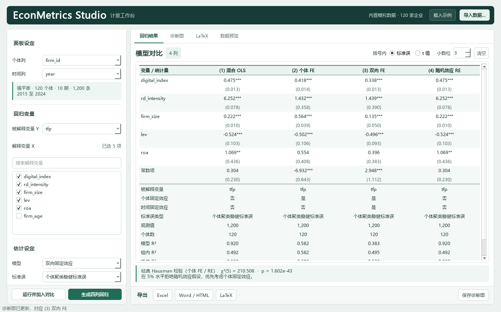

# EconMetrics Studio 经管计量工作台

EconMetrics Studio 是一个离线运行的面板数据分析软件。可以导入 CSV、Excel 或 Stata 数据，设置面板键、比较模型、做 Hausman 检验，并将三线表和诊断图导出。

## 从源码运行

在 Windows 上使用 64 位 Python 3.13，在项目目录中执行以下命令。

    python -m venv .venv
    .\.venv\Scripts\python.exe -m pip install -r requirements.txt
    .\.venv\Scripts\python.exe main_app.py

首次启动会载入 120 家企业、10 年的模拟数据，生成混合 OLS、个体固定效应、双向固定效应和随机效应的四列对比。导入自己的数据后，可以按名称搜索解释变量，并导出 Word、HTML、Excel、LaTeX、PNG 或 PDF。

[查看使用说明和打包方法](使用说明.md)
